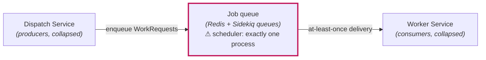
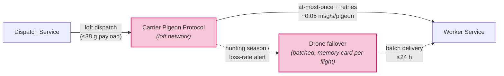
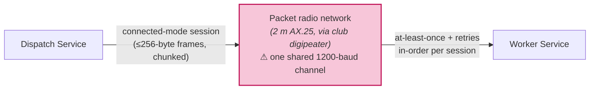
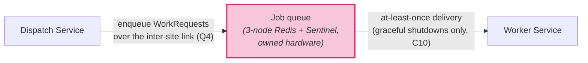

# Example Design Document

| Author         | Status   | Selected Solution                                                                                       |
| -------------- | -------- | ------------------------------------------------------------------------------------------------------- |
| Arlo Quillwick | APPROVED | [Alternate #1 – Carrier Pigeons with Drone Failover](#alternate-approach-1-carrier-pigeons) |

> [!NOTE]
> The system under review is modeled on a real, publicly documented open-source system. That choice is deliberate: idealized example systems are easy to review, and the systems you review at work are complicated and messy. Part of the skill this example demonstrates is simplifying a real system *appropriately* for review — the full walkthrough (what was cut, and the rule behind each cut) is in the [Appendix](#appendix-how-we-simplified-a-real-system).

## TL;DR

The Dispatch Service currently relies on a Redis-backed Sidekiq job pipeline and several supporting systems to transport and process job data. Following the Great SaaS Collapse of 2027, which permanently disabled all major cloud-hosted platforms and managed messaging services, the team must identify a new transport architecture capable of operating independently of traditional cloud infrastructure.

This document evaluates several candidate approaches—including a rebuilt self-hosted broker cluster, a community packet-radio network, and the <a name="cpp"></a>Carrier Pigeon Protocol (CPP)—to determine which solution best satisfies the organization's requirements for reliability, scalability, and operational sustainability.

**Contents:** [Context and Problem](#context-and-problem) · [Candidate Solutions](#candidate-solutions) · [Final Recommendation](#final-recommendation) · [Evaluation Matrix](#evaluation-matrix) · [Design Review Log](#design-review-log) · [Appendix: How We Simplified a Real System](#appendix-how-we-simplified-a-real-system)

## Context and Problem

### Problem Statement

The Great SaaS Collapse of 2027 resulted in the simultaneous failure of every major cloud-hosted platform and managed infrastructure service. While the root cause remains under investigation, preliminary reports suggest a cascading interaction between an AI-generated Kubernetes operator, an autonomous procurement system, and approximately 14 million expired TLS certificates.

As a result, organizations can no longer rely on cloud-hosted messaging systems, managed databases, serverless platforms, or other PaaS offerings. Existing infrastructure must either be self-hosted or replaced with alternatives that can operate independently of the public cloud.

The Dispatch Service currently depends on a distributed messaging architecture that was designed under the assumption that reliable networked infrastructure would continue to exist. That assumption is no longer valid.

Our deployment ran Redis, PostgreSQL, and object storage as managed cloud services; all three are gone. The Platform team has since restored PostgreSQL and object storage on self-hosted hardware, with a database at each site, so that WorkRequests are the only traffic that has to cross between sites (see their design doc, link). The job pipeline is still limping along on a single self-hosted Redis node, scavenged from the old staging rack.

The team must identify a new message-transport architecture capable of supporting job processing in a post-SaaS environment.

### Goals

1. Restore reliable WorkRequest transport between the Dispatch and Worker Services without cloud infrastructure.
2. Preserve the existing WorkRequest contract for downstream consumers.
3. Select a transport the team can operate, maintain, and repair with locally available resources.

### Non-goals

1. Redesigning the Worker Service or the job-processing model.
2. Building a general-purpose messaging platform for other teams.
3. Low-latency (sub-minute) delivery.
4. Replacing PostgreSQL or object storage (restored separately by the Platform team).

### Requirements

| ID  | Requirement | Assess with |
| --- | --- | --- |
| <a name="req-1"></a>Req-1 | Must operate with no dependence on cloud-hosted or managed infrastructure. | Deployment diagram ([Analysis Menu #8](06-analysis-menu.md)) |
| <a name="req-2"></a>Req-2 | Must sustain post-Collapse peak load: ≥2,000 WorkRequests/day with ≤24-hour end-to-end delivery. | Throughput & capacity audit (Appendix A of the [Analysis Menu](06-analysis-menu.md)) |
| <a name="req-3"></a>Req-3 | Must not lose acknowledged WorkRequests; undelivered requests must be detected and retried. | Failure-mode analysis (Appendix A of the [Analysis Menu](06-analysis-menu.md)); staging shadow test |
| <a name="req-4"></a>Req-4 | *(Nice-to-have)* Operating cost at or below pre-Collapse messaging spend. | Cost comparison |
| <a name="req-5"></a>Req-5 | Must be lawful to operate, and ethically defensible. *(Added mid-review; see [Decision 4](#decision-4).)* | Review of each candidate's operating rules against applicable regulations and the organization's code of conduct |

*The "Assess with" column is declared here, with the requirements — before any candidate exists to be scored. The test is chosen before the contestants arrive.*

---

## Candidate Solutions

### Candidate Solution: Status Quo

*The status quo is included as a candidate anyway — it always is, even when events have visibly doomed it. Evaluating it anchors the matrix, puts an explicit price on "do nothing," and keeps the comparison honest. A status quo that scores badly is information, not an insult.*

**High-level Summary**

The Dispatch Service triggers job runs (within the Worker Service) by enqueuing WorkRequests into Redis-backed Sidekiq queues. Sidekiq provides at-least-once execution with automatic retries (but see [C10](#c10)); it does not guarantee strict first-in, first-out (FIFO) ordering. Before the Collapse, the pipeline sustained peak load with comfortable headroom.

Since the Collapse, "status quo" means limping along on the single surviving self-hosted Redis node. It technically satisfies [Req-1](#req-1) — nothing managed remains — but whether one irreplaceable scavenged box counts as *operating* is precisely what the Evaluation Matrix votes disagree about.

<details>
<summary><b>System-Context Diagram</b> — the current state</summary>



</details>

<details>
<summary><b>API/Data Model</b> — Sidekiq publisher and consumer</summary>

Publisher API (Sidekiq)

```ruby
DeliveryWorker.perform_async(work_request_id)
# or, scheduled:
DeliveryWorker.perform_in(5.minutes, work_request_id)
```

Consumer API (Sidekiq)

```ruby
class DeliveryWorker
  include Sidekiq::Worker
  sidekiq_options queue: "push", retry: 5

  def perform(work_request_id)
    # process the WorkRequest
  end
end
```

</details>

### Alternate approach #1: "Carrier Pigeons"

**High-level Summary**

This approach replaces the Redis-backed Sidekiq transport with the [Carrier Pigeon Protocol (CPP)](#cpp). This approach leverages the strength of the local pigeoneer community.

This approach replaces at-least-once with at-most-once-with-retries delivery guarantees. Like the status quo, it offers no strict FIFO ordering (see [C1](#c1) and [Q1](#q1)). The maximum throughput changes to ~3 messages/minute/pigeon (~0.05 messages/second/pigeon).

**Drone failover.** Each loft also keeps a small fleet of quadcopter drones. When pigeons can't fly safely — during hunting season ([RISK-1](#risk-1)), or when loss-rate alerts fire — the lofts switch to drones ([Decision 1](#decision-1)). The switch changes the shape of delivery as well as the carrier. A pigeon carries one WorkRequest; a drone carries a memory card holding everything queued since its last flight. During failover, delivery becomes batched: fewer, larger shipments, still inside [Req-2](#req-2)'s 24-hour window. Publishers don't need to know which carrier was used. Consumers unpack drone batches and receive one WorkRequest at a time, as before.

Drones fail for different reasons than pigeons do, which is why they make a useful failover. They also bring their own constraints: charging power at both lofts, FAA operating rules ([A4](#a4)), and the same weather limits as the birds ([C12](#c12)).

<details>
<summary><b>System-Context Diagram</b> — delta from the status quo highlighted in pink</summary>

*Presented at the* same level of abstraction *as the other approaches under consideration.*



</details>

<details>
<summary><b>API/Data Model</b> — CPP publisher and consumer envelopes (WorkRequest body unchanged)</summary>

The body of the WorkRequest doesn't change. However, the Publisher and Consumer schema envelopes around WorkRequests do change.

Publisher API (CPP)

```
loft.dispatch(
  destinationLoft: LoftId,
  payload: Buffer,         // max 38 grams (CPP payload limit)
  options?: {
    persistent?: boolean;  // silently ignored; see Decision 3
    messageId?: string;
    pigeonClass?: 'standard' | 'express' | 'storm-rated';
    refundOnLoss?: boolean;           // default: false
    allowDroneFailover?: boolean;     // default: true; see Decision 1
  }
): Promise<DispatchTicket>
```

Consumer API (CPP)

```
loft.subscribe(
  loftId: LoftId,
  onArrival: (msg: PigeonDelivery) => Promise<AckResult>,
  options?: {
    autoBand?: boolean;         // auto-ack by removing the leg band on arrival
    rejectMolting?: boolean;    // reject birds in active molt; default true
    // drone batches are unpacked loft-side; onArrival still fires once per WorkRequest
  }
): Promise<{ subscriberTag: string }>
```

</details>

### Alternate approach #2: "Packet Radio"

**High-level Summary**

This approach replaces the Redis-backed Sidekiq transport with AX.25 packet radio on the 2-meter amateur band, relayed through the local amateur radio club's digipeater on the water tower. Like the pigeon proposal, it leans on an existing local community of hobbyists — here, the radio club, whose members already run the digipeater and offered to help.

The Dispatch and Worker Services each get a radio, an antenna, and a terminal node controller (TNC). WorkRequests travel as AX.25 *connected-mode* sessions, which acknowledge and retransmit lost frames, so delivery is at-least-once with retries, the same guarantee as the status quo. Connected mode also delivers frames in order within a session — a property this proposal gets for free and nobody has yet shown we need (see [C1](#c1) and [Q1](#q1)).

Throughput is bounded by a single shared 1200-baud channel. AX.25 frames carry at most 256 bytes of payload by default, so a typical compressed WorkRequest ([A3](#a3)) is chunked across several frames. Whether the channel can actually carry peak load is the open part of the case; see [C8](#c8). Retries help only against independent failures; see [RISK-4](#risk-4).

<details>
<summary><b>System-Context Diagram</b> — delta from the status quo highlighted in pink</summary>

*Presented at the* same level of abstraction *as the other approaches under consideration.*



</details>

<details>
<summary><b>API/Data Model</b> — packet-radio publisher and consumer (WorkRequest body unchanged)</summary>

The body of the WorkRequest doesn't change. The envelope does: every transmission must carry a licensed operator's callsign, and the payload is split into frames.

Publisher API (packet radio)

```
tnc.send(
  destination: Callsign,   // the Worker Service's station
  payload: Buffer,         // chunked into frames of ≤ paclen bytes
  options: {
    sourceCallsign: Callsign;  // required: a licensed control operator (see C7)
    via?: Callsign[];          // digipeater path, e.g. ['WATRTWR']
    paclen?: number;           // default 256
    maxRetries?: number;       // default 10
  }
): Promise<DeliveryReceipt>
```

Consumer API (packet radio)

```
tnc.listen(
  ownCallsign: Callsign,
  onMessage: (msg: ReassembledPayload) => Promise<void>,
  options?: {
    discardIncomplete?: boolean;  // drop payloads with missing frames; default true
  }
): Promise<{ listenerId: string }>
```

</details>

### Alternate approach #3: "Rebuilt Broker Cluster"

**High-level Summary**

This approach keeps the software and replaces the hardware. It differs from the status quo, which keeps the one scavenged node and changes nothing: here, Redis is rebuilt as a three-node cluster on machines we own, with Redis Sentinel handling failover and append-only-file persistence turned on. Three is the smallest count that lets Sentinel reach a majority vote and pick a new primary when one node dies. Sidekiq, the queues, and every producer and consumer stay exactly as they are.

Its strongest argument is the API diff, which is empty: no envelope changes, no chunking, no new failure vocabulary. Its weakest point is that it inherits two things from the status quo unexamined — the network between sites ([C9](#c9)) and Sidekiq's crash behavior ([C10](#c10)).

<details>
<summary><b>System-Context Diagram</b> — delta from the status quo highlighted in pink</summary>

*Presented at the* same level of abstraction *as the other approaches under consideration.*



</details>

<details>
<summary><b>API/Data Model</b> — unchanged from the status quo</summary>

No change. Publisher and consumer code are identical to the [status quo's](#candidate-solution-status-quo). Only connection configuration changes: clients point at the Sentinels instead of a single Redis host.

</details>

---

## Final Recommendation

*The Final Recommendation identifies the selected solution, summarizes why it was chosen, and highlights any significant tradeoffs or remaining risks.*

*Its purpose is to help future readers quickly understand the outcome of the design review.*

### Selected Solution

*[Alternate #1 — Carrier Pigeons with Drone Failover](#alternate-approach-1-carrier-pigeons)*

This solution received the highest weighted score in the [Evaluation Matrix](#evaluation-matrix) and best satisfied the documented requirements. The full debate — the concerns raised, the assumptions tested, and the decisions that shaped this solution — is preserved in the [Design Review Log](#design-review-log).

**Key reasons**

- Reduced infrastructure cost.
- Satisfies reliability requirements when combined with drone failover.
- Simpler operational model than the status quo.
- Failures are mostly independent: a lost pigeon doesn't make the next one likelier to be lost, so retries work. Radio's retries go through the same digipeater and channel ([RISK-4](#risk-4)).
- Scored highest after the [Req-5](#req-5) re-vote. Packet radio, second before the re-vote, fell to last.

**Accepted tradeoffs**

- Lower throughput than the current system.
- Increased exposure to avian-related failure modes.

## Evaluation Matrix

*The evaluation matrix captures how well each candidate solution satisfies the documented requirements.*

*Using the evidence gathered through analyses, each reviewer independently votes* ***Yes (1)***, ***Unknown (0)***, *or* ***No (-1)*** *for every requirement/solution pair.*

*Reviewers should evaluate whether a solution satisfies the requirement, not whether they personally prefer it.*

*The matrix makes agreement, disagreement, and uncertainty visible and provides a structured basis for selecting a solution.*

*Each requirement's assessment method was declared up front, alongside the requirement itself — see the [Requirements](#requirements) table.*

**Candidate: Status Quo**

| Reviewer | [Req-1](#req-1) | [Req-2](#req-2) | [Req-3](#req-3) | [Req-4](#req-4) *(nice-to-have)* | [Req-5](#req-5) |
| --- | --- | --- | --- | --- | --- |
| Arlo | Yes | Yes | Yes | Yes | Yes |
| Dexter | Yes | Unknown | Unknown | No | Yes |
| Lyra | Unknown | Yes | Unknown | Unknown | Yes |
| Tobin | No | No | Unknown | No | Yes |
| ***Subtotal*** | **1** | **1** | **1** | **−1** | **4** |

**Candidate score: 1 + 1 + 1 − 1 + 4 = 6**

**Candidate: Alternate #1 — Carrier Pigeons**

| Reviewer | [Req-1](#req-1) | [Req-2](#req-2) | [Req-3](#req-3) | [Req-4](#req-4) *(nice-to-have)* | [Req-5](#req-5) |
| --- | --- | --- | --- | --- | --- |
| Arlo | No | Yes | No | Unknown | Yes |
| Dexter | Yes | Yes | No | Yes | Yes |
| Lyra | Yes | Unknown | Unknown | Yes | Unknown |
| Tobin | Yes | Yes | Yes | Yes | Yes |
| ***Subtotal*** | **2** | **3** | **−1** | **3** | **3** |

**Candidate score: 2 + 3 − 1 + 3 + 3 = 10**

**Candidate: Alternate #2 — Packet Radio**

| Reviewer | [Req-1](#req-1) | [Req-2](#req-2) | [Req-3](#req-3) | [Req-4](#req-4) *(nice-to-have)* | [Req-5](#req-5) |
| --- | --- | --- | --- | --- | --- |
| Arlo | Yes | Unknown | Unknown | No | Unknown |
| Dexter | Yes | Unknown | Yes | No | No |
| Lyra | Unknown | No | Yes | Yes | No |
| Tobin | Yes | Yes | Yes | Yes | Unknown |
| ***Subtotal*** | **3** | **0** | **3** | **0** | **−2** |

**Candidate score: 3 + 0 + 3 + 0 − 2 = 4**

**Candidate: Alternate #3 — Rebuilt Broker Cluster**

| Reviewer | [Req-1](#req-1) | [Req-2](#req-2) | [Req-3](#req-3) | [Req-4](#req-4) *(nice-to-have)* | [Req-5](#req-5) |
| --- | --- | --- | --- | --- | --- |
| Arlo | Yes | Yes | Yes | Yes | Yes |
| Dexter | Yes | Unknown | No | No | Yes |
| Lyra | Yes | Unknown | Unknown | No | Yes |
| Tobin | Yes | No | Unknown | Unknown | Yes |
| ***Subtotal*** | **4** | **0** | **0** | **−1** | **4** |

**Candidate score: 4 + 0 + 0 − 1 + 4 = 7**

*Req-5 was added mid-review. Until then no requirement covered legality, so the open question in [Q3](#q3) cost radio nothing; [C7](#c7) surfaced the gap, and every candidate was re-voted on the new requirement ([Decision 4](#decision-4)). Before the re-vote, radio stood second. When the Log turns up a missing requirement, add it and re-vote; don't argue around the score.*

| Candidate | Final score |
| --- | --- |
| Status Quo | 6 |
| [Alternate #1 — Carrier Pigeons](#alternate-approach-1-carrier-pigeons) | **10** |
| [Alternate #2 — Packet Radio](#alternate-approach-2-packet-radio) | 4 |
| [Alternate #3 — Rebuilt Broker Cluster](#alternate-approach-3-rebuilt-broker-cluster) | 7 |

## Design Review Log

*The Design Review Log is the record of the debate. Concerns enter the log the moment a reviewer notices them; each one leaves by resolving into an open question, an assumption, a risk, or a decision.*

### Concerns

*Reviewer Concerns are observations that may indicate a missing assumption, unresolved question, hidden dependency, unstated requirement, or design risk.*

*Reviewers do not need to fully formulate a concern before recording it. Concerns should be captured as soon as they are noticed, then refined through discussion.*

*Concerns should not remain open indefinitely. They are typically resolved by becoming an Open Question, Assumption, Risk, or Decision.*

| ID | Status | Concern | Raised By | Assigned To | Addressed by… |
| --- | --- | --- | --- | --- | --- |
| <a name="c1"></a>C1 | IN PROGRESS | Proposal appears to assume downstream consumers require FIFO ordering, but I cannot find evidence that this requirement exists. | Arlo | Dexter | [Q1](#q1) |
| <a name="c2"></a>C2 | OPEN | Cost estimates seem highly sensitive to message volume assumptions. | Tobin |  |  |
| <a name="c3"></a>C3 | RESOLVED | Failure-handling behavior was unclear. | Lyra | Dexter | [Q2](#q2), [Decision 1](#decision-1) |
| <a name="c4"></a>C4 | IN PROGRESS | How often do deliveries fail due to hawk predation? | Arlo | Tobin | [A2](#a2) |
| <a name="c5"></a>C5 | RESOLVED | What happens if a WorkRequest is too large for a pigeon to carry? | Lyra | Dexter | [A1](#a1), [RISK-2](#risk-2), [Decision 2](#decision-2) |
| <a name="c6"></a>C6 | RESOLVED | What happens when it's not safe for pigeons to fly? | Arlo | Dexter | [Q2](#q2), [RISK-1](#risk-1), [Decision 1](#decision-1) |
| <a name="c7"></a>C7 | RESOLVED | Surely we can't run company traffic over ham radio? Asked which requirement that violates, nobody could name one — so this is a missing requirement ([Find the Missing Requirement](05-how-to-surface-hidden-assumptions.md#find-the-missing-requirement)). | Dexter | Lyra | [Req-5](#req-5), [Decision 4](#decision-4), [Q3](#q3) |
| <a name="c8"></a>C8 | IN PROGRESS | The packet-radio channel budget looks tight once digipeating and the club's own traffic are counted. | Lyra | Tobin | [A3](#a3); staging shadow test |
| <a name="c9"></a>C9 | IN PROGRESS | Every broker candidate, status quo included, assumes a working network link between the Dispatch and Worker sites. Nothing in this doc says what that link is or how long it will last. | Arlo | Tobin | [Q4](#q4) |
| <a name="c10"></a>C10 | RESOLVED | Open-source Sidekiq's at-least-once guarantee holds only for graceful shutdowns: if a worker process crashes, the jobs it was running are lost ([Sidekiq wiki](https://sidekiq.org/wiki/Reliability)). | Dexter | Lyra | [RISK-3](#risk-3) |
| <a name="c11"></a>C11 | RESOLVED | Radio retries aren't independent trials. If the digipeater, a TNC, or the channel itself fails, every retry fails the same way, and there is nothing else to fall back to. | Lyra | Tobin | [RISK-4](#risk-4) |
| <a name="c12"></a>C12 | IN PROGRESS | [Q2](#q2) asked about hurricanes *and* hunting season, but [Decision 1](#decision-1) only covers hunting season. Small drones are grounded by high wind too, so in a storm neither carrier flies. | Dexter | Lyra | [Q5](#q5) |

### Open Questions

*Questions whose answers could materially change the design, requirements assessment, implementation plan, or risk profile.*

*Questions that* cannot *materially affect the decision should generally be answered during implementation rather than tracked here.*

| ID | Status | Question | Owner | Outcome |
| --- | --- | --- | --- | --- |
| <a name="q1"></a>Q1 | OPEN | Do any downstream consumers require strict FIFO ordering? | Dexter |  |
| <a name="q2"></a>Q2 | RESOLVED | Are there any affordable fall-back delivery methods when pigeons can't fly (e.g. during hurricanes or hunting season)? | Lyra | [Decision 1](#decision-1) (hunting season only; see [C12](#c12)) |
| <a name="q3"></a>Q3 | OPEN | Is carrying WorkRequests over amateur frequencies permitted? [47 CFR §97.113](https://www.ecfr.gov/current/title-47/chapter-I/subchapter-D/part-97/subpart-B/section-97.113) bars amateur stations from transmitting communications on behalf of an employer, and messages encoded to obscure their meaning, which rules out encrypting the payload. (Whether the FCC still answers the phone post-Collapse is not evidence either way.) The answer decides whether Alternate #2 can meet [Req-5](#req-5). | Lyra |  |
| <a name="q4"></a>Q4 | OPEN | What carries traffic between the Dispatch and Worker sites today, and how long is it expected to last? (If the answer is "nothing reliable," that is why the pigeon and radio candidates exist at all.) | Tobin |  |
| <a name="q5"></a>Q5 | OPEN | What carries WorkRequests when neither pigeons nor drones can fly (for example, during a hurricane), and is a backlog of up to the storm's length acceptable under [Req-2](#req-2)? | Lyra |  |

### Assumptions

*Assumptions are statements we currently believe to be true and are using as inputs to the design.*

*Each assumption must include supporting evidence. Unsupported assumptions should be converted into open questions.*

**What IS supporting evidence for an assumption?**

*There are three kinds of valid supporting evidence. From strongest to weakest, they are:*

- *HIGH: Empirical data or rigorous "mathematical" proofs. Must link to said data or proofs.*
- *MEDIUM: References to documents or plans (e.g. yearly roadmap, product prioritization doc, prior design docs, etc.). Must link to said documents.*
- *LOW: Statements someone trustworthy made. Must name the person, the date they said it, and the context in which they said it (e.g. 1:1 meeting, backlog refinement, etc.).*

*"Confidence" reflects the strength of the supporting evidence,* not *the importance of the assumption.*

| ID | Assumption | Confidence | Evidence |
| --- | --- | --- | --- |
| <a name="a1"></a>A1 | WorkRequest payloads can be compressed to fit within the 38-gram CPP payload limit. | HIGH | 1. Analysis of the last 30 days of production traffic (link). 2. Test compression results (link). |
| <a name="a2"></a>A2 | Predation-related message loss will remain below 0.1% annually. | MEDIUM | 1. Statement from Greg-The-Local-Pigeon-Guy at the dart tournament at the Rusty Anchor. 2. Regional hawk population survey (link). |
| <a name="a3"></a>A3 | Compressed WorkRequests average ≤2 KB. At peak (2,000/day) that is ≈4 MB/day, or ≈370 bit/s averaged over 24 hours — about 31% of a 1200-baud channel before protocol overhead. A digipeater retransmits on the same frequency, so every frame occupies the channel twice: ≈62%, before acknowledgments, retries, bursts, or anyone else's traffic. | HIGH (sizing only) | 1. Same 30-day production-traffic analysis as [A1](#a1) (link). 2. Channel arithmetic shown here. *Whether the remaining headroom survives real contention is not covered by this evidence; that is what C8's shadow test is for.* |
| <a name="a4"></a>A4 | Drone failover flights can be run within FAA Part 107: a certified remote pilot at the launching loft, plus visual observers stationed along the route so someone can see the drone at all times. The alternative, a beyond-visual-line-of-sight waiver, is historically hard to get, so the design does not rely on one. | MEDIUM | 1. [14 CFR §107.31](https://www.law.cornell.edu/cfr/text/14/107.31) (visual line of sight). 2. Route survey of observer positions (link). |

### Risks

*Risks are potential negative outcomes that may occur even if the design is implemented correctly and all assumptions prove true.*

*Each risk should describe the potential impact, likelihood (if known), and any planned mitigations.*

*Focus on meaningful risks that could influence the design decision or implementation plan. Avoid listing generic project risks that apply equally to nearly every project.*

**<a name="risk-1"></a>RISK-1: Seasonal Pigeon Loss Due to Hunting Activity**

**Impact:** HIGH · **Likelihood:** MEDIUM

During designated pigeon hunting seasons, carrier pigeons may be injured, killed, or diverted from their intended routes, resulting in increased message loss and delivery delays.

*Mitigation*

- Maintain an up-to-date map of hunting zones and avoid routing through affected areas where possible.
- Increase message redundancy by dispatching multiple pigeons for critical requests.
- Automatically fail over to alternate transport mechanisms (e.g. drones) during periods of elevated avian attrition.
- Monitor pigeon loss rates and establish alerting thresholds for unusual seasonal degradation.

*Residual Risk*

Even with mitigations, localized hunting activity may cause temporary reductions in system reliability and increase operating costs due to higher pigeon replacement rates.

**<a name="risk-2"></a>RISK-2: Payload Growth Exceeds CPP Transport Limits**

**Impact:** HIGH · **Likelihood:** LOW

Future enhancements to WorkRequest messages may increase payload sizes beyond the 38-gram carrying capacity supported by the Carrier Pigeon Protocol. This could prevent certain requests from being delivered without additional engineering work.

*Mitigation*

- Monitor payload size distributions as part of normal service telemetry.
- Establish automated alerts when payload sizes approach 80% of the CPP limit.
- Define and document payload size budgets for new features.
- Design message schemas to support future chunking or attachment offloading if required.

*Residual Risk*

Unexpected feature growth, new data requirements, or insufficient compression ratios may still require a future migration effort or the introduction of message chunking, potentially increasing system complexity and operational costs.

**<a name="risk-3"></a>RISK-3: In-Flight Job Loss on Worker Crash** *(Status Quo, Alternate #3)*

**Impact:** HIGH · **Likelihood:** MEDIUM

Open-source Sidekiq removes a job from Redis when a worker fetches it. If that worker process crashes before finishing, the job is gone, with no record that it was ever lost. This breaks [Req-3](#req-3) silently. On scavenged, unmonitored post-Collapse hardware, unclean crashes are more likely than they were before.

*Mitigation*

- Make WorkRequests idempotent, and run a periodic reconciliation sweep that compares dispatched requests against completed ones and re-enqueues the gap.
- Evaluate open-source reliable-fetch strategies that keep in-progress jobs in Redis until they are acknowledged.
- Sidekiq Pro's `super_fetch` solves this directly, but it requires a commercial license and vendor-hosted distribution; whether either survived the Collapse is unknown.

*Residual Risk*

The reconciliation sweep detects loss after the fact rather than preventing it, so delivery of lost jobs is delayed by up to one sweep interval.

**<a name="risk-4"></a>RISK-4: Correlated Failure in the Radio Path** *(Alternate #2)*

**Impact:** HIGH · **Likelihood:** MEDIUM

Retries only help when failures are independent. A lost pigeon says nothing about the next pigeon. Every radio retry, by contrast, uses the same digipeater, the same pair of TNCs, and the same channel. If any of those is damaged, jammed, or simply off the air, every retry fails identically, and delivery stops until a human repairs it. (Pigeon losses aren't perfectly independent either: hunting season correlates them, which is what [RISK-1](#risk-1) and [Decision 1](#decision-1) handle.)

*Mitigation*

- Keep spare radio and TNC kits on hand at both sites.
- Establish a second relay path that doesn't share the water-tower digipeater, or a direct path if the sites have line of sight.
- Designate a fallback transport, from a different failure family, for outages longer than the delivery window ([Req-2](#req-2)).

*Residual Risk*

Interference or jamming on the shared channel affects every path on that frequency at once; spare hardware does not help.

### Decisions

*A running log of decisions made during the design and review of this doc. This is the home for "why we chose X over Y" content that often ends up stranded in comment threads.*

#### Decision 1

Fall back to using quadcopter drones instead of pigeons during hunting season.

*Reasoning & Supporting Evidence*

Drones fail for different reasons than pigeons do. Hunting and hawk predation, the main ways pigeons are lost ([RISK-1](#risk-1), [A2](#a2)), don't affect drones, so during hunting season a drone flight succeeds or fails independently of the pigeons. Radio lacks that property ([RISK-4](#risk-4)). Sending extra pigeons was considered and rejected: during hunting season, extra birds fly into the same guns. Because a drone carries a whole batch per flight, a small fleet covers [Req-2](#req-2)'s volume. Costs accepted: charging power at both lofts and the operating constraints in [A4](#a4). This decision does not cover storms; see [C12](#c12).

#### Decision 2

Adopt CPP without implementing payload chunking.

*Reasoning & Supporting Evidence*

Analysis of the last 90 days of production traffic showed 99.8% of requests fit within the payload limit after compression (link).

#### Decision 3

Accept the `persistent` publish option as a silent no-op under CPP.

*Reasoning & Supporting Evidence*

CPP provides no durable in-flight storage between lofts; durability is provided by dispatch tickets plus retry instead (see [RISK-2](#risk-2) monitoring). Emulating broker-style persistence would require loft-side storage that no documented requirement demands.

#### Decision 4

Add [Req-5](#req-5) (lawful and ethically defensible operation) mid-review, and re-vote every candidate on it.

*Reasoning & Supporting Evidence*

[C7](#c7) found that the strongest objection to packet radio corresponded to no documented requirement. Leaving the gap would have let the matrix rank a possibly unlawful transport second. Lyra's Unknown on pigeons reflects flying live birds through hunting season ([RISK-1](#risk-1)).

## Appendix: How We Simplified a Real System

The current state in this example is modeled on a real, publicly documented system: Mastodon's background-job pipeline (see the [official scaling documentation](https://docs.joinmastodon.org/admin/scaling/) and [Rochko, *Scaling Mastodon*](https://blog.joinmastodon.org/2017/04/scaling-mastodon/)).

**The real system**, as its documentation describes it:

- Three process types: **Web (Puma)**, the **Streaming API** (Node.js), and **Sidekiq** workers.
- Background jobs flow through six named Sidekiq queues: `default` (everything affecting local users), `ingress` (incoming federation traffic), `push` (delivery to other servers), `pull` (low-priority work: imports, backups, link previews, thread resolution), `mailers` (email), and `scheduler` (cron-like jobs; must run on exactly one process).
- Backing services: **PostgreSQL**, **Redis** (queue transport and cache), **object storage** for media, optional **Elasticsearch**, and an SMTP provider.
- The documented operational pain: Sidekiq drains queues in priority order, so an overfilled high-priority queue starves everything behind it; operators respond by splitting queues across dedicated processes and machines.

```mermaid
flowchart LR
    subgraph PROD["PRODUCERS — collapse to 'Dispatch Service': internals identical under every candidate"]
        WEB["Web (Puma)"]
        STR["Streaming API (Node.js)"]
    end
    subgraph TRANS["REDIS + SIX SIDEKIQ QUEUES — the boundary under review: keep visible, collapse topology to 'the job queue'"]
        Qd[["default"]]
        Qi[["ingress"]]
        Qp[["push"]]
        Ql[["pull"]]
        Qm[["mailers"]]
        Qs[["scheduler ⚠ exactly one process"]]
    end
    subgraph CONS["CONSUMERS — collapse to 'Worker Service': WorkRequest contract preserved"]
        SK["Sidekiq worker fleet"]
    end
    subgraph CUT["CUT, BUT LISTED — no candidate touches these; a reviewer can veto any cut"]
        PG[("PostgreSQL")]
        OS[("object storage")]
        ES[("Elasticsearch")]
        SMTP["SMTP provider"]
    end
    WEB -->|"enqueue"| TRANS
    STR -->|"enqueue"| TRANS
    TRANS -->|"priority-ordered drain<br/>(a full high-priority queue<br/>starves those behind it)"| SK
    WEB -.->|"reads/writes,<br/>unchanged"| CUT
    SK -.->|"reads/writes,<br/>unchanged"| CUT
    classDef cutstyle fill:#f0f0f0,stroke:#aaaaaa,color:#888888
    class PG,OS,ES,SMTP cutstyle
    class CUT cutstyle
    style TRANS stroke:#c2185b,stroke-width:3px
```



**How we simplified it for this review.** Every box in the main document's diagrams is a deliberate collapse of the system above, and each cut has a rule:

| Real component(s) | In this document | Rule applied |
| --- | --- | --- |
| Web + Streaming (the job *producers*) | "Dispatch Service" | Collapse everything on the producing side of the boundary under review into one box — its internals are identical under every candidate. |
| Redis + the six Sidekiq queues (the *transport*) | "the job queue" | This is the boundary being redesigned: keep it visible, but collapse queue topology at this level. Queue-level detail reappears only where a candidate changes it. |
| The Sidekiq worker fleet (the *consumers*) | "Worker Service" | Same rule as producers: the consumers' contract (WorkRequests) is preserved, so their internals stay collapsed. |
| PostgreSQL, object storage, Elasticsearch, SMTP | Omitted from diagrams, listed here | Cut what no candidate touches — but *list the cuts*, so a reviewer can veto one ("doesn't this affect media delivery?") instead of discovering it after the decision. |
| `scheduler`'s one-process-only invariant | Carried as a constraint note | Keep any invariant a candidate could silently violate, even when its home component is collapsed. |

The simplification itself is reviewable: if you believe a cut component is load-bearing for this decision, that belongs in the [Design Review Log](#design-review-log) as a concern.
