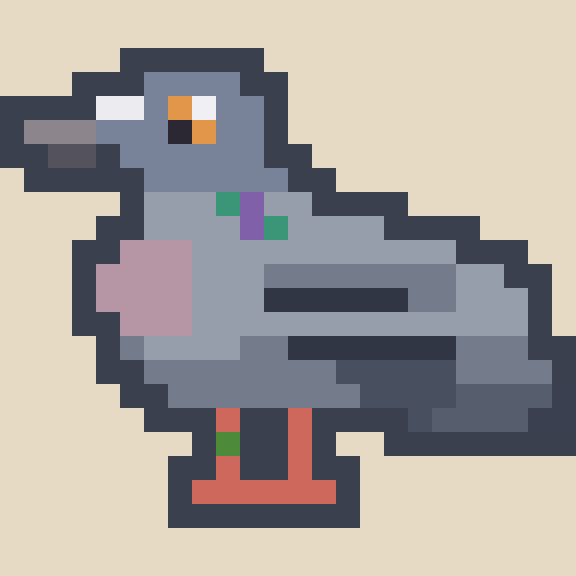
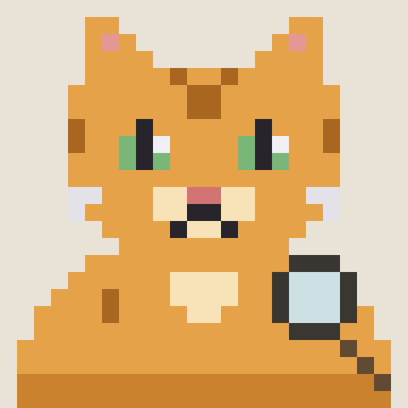

# Technical Design Review Guidelines

## What This Is

A complete, working design-review curriculum: the case for design review (and when it isn't worth the effort), a step-by-step process, guides for authors and reviewers, techniques for surfacing hidden assumptions, a menu of analyses, formatting rules, a reusable template, and a fully worked example.

These documents are the artifact of a real engineering team. They were written to end recurring technical disputes — trench warfare — by replacing them with rigorous, consistent, quantifiable decision standards, and they were used in earnest. The "we" throughout is the team that worked by them; the documents have been lightly adapted for a public audience. With thanks to my team — not everything in here was my idea first.

This collection supplements rather than replaces a team's existing design-proposal process: it provides practical guidance for the more cognitively demanding and ambiguous parts — evaluating candidate solutions, surfacing assumptions and risks, communicating clearly, documenting design decisions, and conducting effective reviews — so teams can reach well-supported decisions with less time and effort.

## Where to Start

**[1. The Why](01-the-why.md)** — Explains why design reviews exist, when they are worth the effort, and how they complement experimentation, prototyping, and implementation.

**[2. The Process](02-the-process.md)** — Describes the step-by-step process for creating, reviewing, evaluating, and selecting among candidate solutions.

## Participation Guides

Practical guidance for engineers actively participating in design reviews, whether as authors or reviewers. The Process describes *what* steps to follow; these guides focus on *how* to perform those steps effectively.

- [3. Writing Design Docs Effectively](03-writing-design-docs-effectively.md) — Guidance for authors on structuring design documents, communicating clearly, and making proposals easy to review.
- [4. Reviewing Designs Constructively](04-reviewing-designs-constructively.md) — Guidance for reviewers on identifying risks, assumptions, and tradeoffs while providing actionable, decision-oriented feedback.
- [5. How To Surface Hidden Assumptions](05-how-to-surface-hidden-assumptions.md) — Practical techniques for authors and reviewers to identify assumptions, unstated requirements, and hidden reasoning that may influence a design decision.
- [6. Analysis Menu](06-analysis-menu.md) — A catalog of analyses and diagrams that can be used to evaluate candidate solutions, reduce uncertainty, and gather evidence during design review.
- [7. Oddly Specific Formatting Rules](07-oddly-specific-formatting-rules.md) — Formatting and organization conventions that improve readability, reviewability, and long-term maintainability of design documents.

## Examples and Templates

Reference materials demonstrating what completed design-review artifacts should look like, along with a reusable template for creating new documents.

- [8. Design Document Template](08-design-document-template.md) — A reusable starting point for new design reviews that includes the standard sections, structure, and placeholders expected by this process.
- [9. Example Design Document](09-example-design-document.md) — A completed example illustrating how requirements, candidate solutions, analyses, assumptions, risks, decisions, and review feedback come together in a finished design document. The example is deliberately fictional (the Carrier Pigeon Protocol): nobody can get entrenched defending pigeons.

## The Cast

The example's author and reviewers are fictional, but their disagreements are not.

| | Reviewer | |
| --- | --- | --- |
|  | **Arlo Quillwick** | New to the team, but very senior. Very opinionated about why strongly-typed languages are best. |
|  | **Dexter** | An ambitious junior. Very opinionated about why strongly-typed languages are the *worst*. |
|  | **Lyra** | Prone to going off the rails toward monads. Resolves disputes by lecturing everyone on how the problem should properly be formulated in Lean, until the team gives up and decides by dice roll. |
|  | **Tobin** | Recruited Arlo. Major contributor to an open-source cuneiform-based operating system. |
